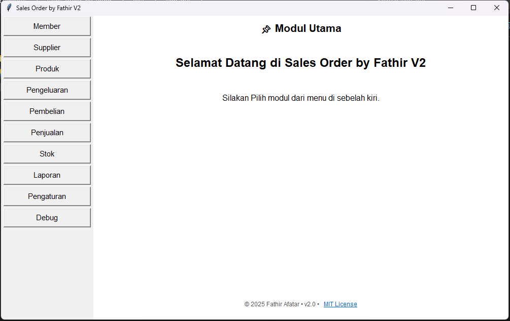
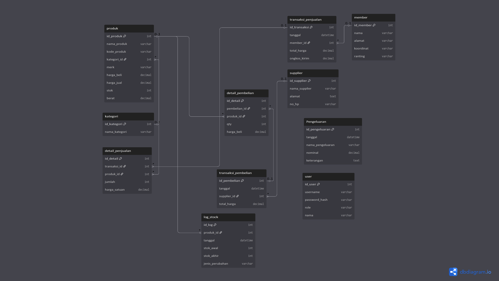
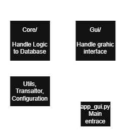
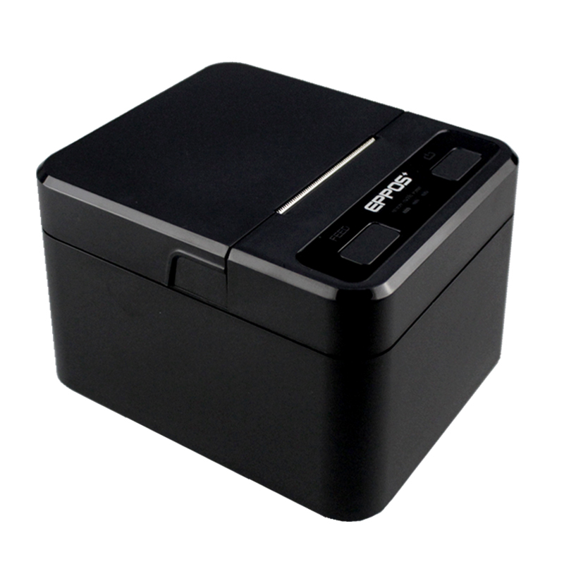

# Sales Order by Fathir


> Created by **Fathir Afatar**

A lightweight, standalone desktop Sales Order (POS) and inventory management system designed to eliminate manual billing and streamline order processing.

---

## 📌 Overview

**Sales Order by Fathir** was built to solve everyday retail operational bottlenecks—replacing handwritten receipts and manual calculations with an automated workflow. It handles everything from stock replenishment to automated receipt printing via thermal printers, minimizing human error and accelerating checkout times.

## 📸 Preview


> Main menu, default in Indonesia Language. It can be changed via "Pengaturan" --> "Bahasa / Language" --> English --> "Terapkan Bahasa".
---

## ⚡ Key Value & Benefits

| Operational Area | Manual Workflow | Sales Order (Automated) |
| :--- | :--- | :--- |
| **Receipt Generation** | Slow handwritten invoices | **Instant Thermal Printouts** |
| **Calculation Accuracy** | Prone to human math errors | **100% Automated Subtotals & Totals** |
| **Inventory Tracking** | Manual stock registers | **Automated Stock Updates on Purchase/Sale** |
| **Data Integrity** | Isolated paper receipts | **Centralized Local SQLite History** |

---

## ✨ Key Features

- **Master Data Management:** Comprehensive management of Members/Customers, Suppliers, and Product catalogs.
- **Transaction Processing:** 
  - **Purchases:** Easily log restocking transactions to automatically increase item inventories.
  - **Sales:** Process customer checkouts with real-time stock deductions and instant receipt generation.
  - **Expenses:** Log operational expenses to keep track of store cash flow.
- **Inventory Control:** Live stock tracking with real-time updates based on incoming and outgoing transactions.
- **Hardware Integration:** Built-in settings for direct receipt printing to thermal printers supporting standard ESC/POS commands.
- **Settings:** Added settings for receipt format, printer test, and language.
- **Debug:** Added to view database logs, system status (for the number of databases and printer status), and receipt print tests
- **Bilingual:** Choose Indonesia or English Language.


---

## 🔄 Transaction & Inventory Workflow


## SQL Schema


## Application Architecture

## 📁 Repository Structure
```
├── app/               # Python source code files (Tkinter UI & SQLite logic)
├── config/            # cofiguration file for printer and receipt (nota) (.json)
├── data/              # App screenshots and UI resources
├── docs/              # First milestone, about printer thermal
├── escpos/            # Testing configuration thermal printer
├── local_escpos       # library from another repository
├── tools              # dll file for thermal printer
├── app_gui.py         # Main menu for application
├── requirements.txt   # Dependencies list
├── LICENSE            # Open-source MIT License
└── README.md          # Project documentation
```

## 🚀 Getting Started
Prerequisites
- Operating System: Windows

- Python 3.x installed on your machine.

- ESC/POS compatible Thermal Printer (connected via USB/Serial/Network).

## Installation
1. Clone the repository:

```
git clone https://github.com/Fathir-Afatar/Sales-Order-by-Fathir.git
```
2. Manage to the project folder:
```
cd sales-order-by-fathir
```

3. Install dependencies:

Bash
```
pip install -r requirements.txt
```
3. Run the application:

Bash
```
python app_gui.py
```

or

Using the release version instead.

## ⛔ Current Limitations
- Platform Dependent: Optimized exclusively for Windows OS environments.

- Printer Compatibility: Strictly supports thermal printers using standard ESC/POS protocols.

- Single-User / Standalone: Local SQLite database setup; does not support multi-device concurrent networking.

- Fixed Templates: Receipt output layouts are currently hardcoded and non-customizable.

- Local Storage: No built-in automated cloud backup mechanisms (data is stored strictly on the host PC).

- The Stock Menu, especially on Card Stock, there is bug number on (OUT/Keluar), but the calculation is correct.

## 🗺️ Future Roadmap & Next-Gen Evolution
[x] Web & Multi-User Architecture (Separate Repo): Migration to Django Framework + PostgreSQL to enable multi-device network access and cloud capability.

[ ] Automated local database backup utility.

[ ] Customizable receipt template designer.

[ ] Expanded analytics and daily sales revenue reporting.

# Thermal Printer Setup for Sales Order by Fathir

This guide helps users to connect a thermal printer to the Sales Order by Fathir application (version 2). Follow these steps so that the printer can be detected and used smoothly.

---

## 1. Preliminary Preparation

### What is needed:

- Thermal printer (for example: XPrinter, Epson, Eppos, etc.)
- Printer USB cable
- Windows 10 or 11 operating system
- Sales Order by Fathir application (version 2)
- Make sure the thermal printer supports **ESC/POS** Command
> This app worked perfectly on EPPOS Thermal Printer.

## 2. USB Driver Installation

1. Plug the printer into a USB port
2. Run 'Zadig.exe' or you can download it on the internet
3. In Zadig: 
  - Select the thermal printer from the USB devices list 
  - Select driver: `WinUSB (v6.1.7600.16385)` 
  - Click **Install Driver**
4. Wait until the process is complete and make sure the printer appears in Device Manager as 'USB Input Device' or similar. Or sometimes called `micro-printer`

## 3. Printer Detection Test

1. Run the Sales Order application
2. Go to the **Settings > Printer Test & Settings** Tab
3. In the Select USB Printer menu, if the printer is detected a list will appear as follows
28e9:289
4. Click the **Test Print** button
5. If successful, the printer will print the text "Print Test successful"

---

## 4. Save Default Printer

1. After selecting a printer from the list, click **Save Default Printer**
2. This printer will be used automatically when printing sales receipts

---

5. Print the Sales Note

Once the printer is saved as default:
- Every sales transaction will automatically print a receipt to the thermal printer
- If the printer is not connected, the system will save the fallback note to a `.txt` file

---


## 6. Troubleshooting

| Problem | Solution |
|--------|--------|
| The printer does not appear in the list | Make sure the USB cable is plugged in and the drivers are installed with Zadig |
| Print test failed (Access Denied) | Run the application as Administrator |
| Print failure note | Make sure the default printer is saved and the `libusb1` backend is active |
| The log `Detach kernel driver failed` | Ignore it if the print still succeeds—it's just a warning in Windows |

## Additional Tips

- Use the same USB port every time you turn on the printer
- Do not open other applications that can access the thermal printer directly

## Printer Specification

Currently, this app works perfectly with these printer.

> Printer Thermal EPPOS PLUS 80mm POS80L - USB BLUETOOTH

| Name | Metric |
| :--- | :--- |
| Printing Method| Thermal line printing|
| Print columns | 384dots/lines|
| Character Set | ANK character |
| Font A | 12*24dots |
| Font B | 9*17dots |
| Jan/traditional form | 24*24dots |
| Barcode type | UPC-A/UPC-E/JAN13(EAN13)/JAN8(EAN8)/CODE39/ITF/CODABAR/CODE93/CODE128 |
| Auto-cutter | NO |
| Interface | USB+cashbox+Mullti-Bluetooth |
| Power | DC 9V/3A |
| Cashbox control | DC 12V/1A |
| Printing command | Compatible with `POS/ESC` command set |
| Paper Width | 80mm | 
| Temperature | 0~45ºC |
| Dampness | 10~80% |
| Paper thickness | 0.06~0.08mm |
| Max diameter of paper roll | 50mm |
| Weight | 339g |
| Dimension | 144 x 110 x 84 (W x H x D) |
| Drivers |  Win9X//Win10//Win11WinME/Win2000/WinNT/WinXP/Vista,compatible withEPSON,SAMSUNG |

# Changelog

Format : [Version] - Date

## [v2.0] - 2025-10-14

### Added
- Import from Excel (Member, Product, Supplier)
- Image download for Detail Receipt
- Fix many bugs from previous version
- Settings for Receipt format, thermal printer
- Debug for System Logs, System Status, Receipt Print Test
- Stock (Beta)
- Report (more on Sales, Procurement, Expense, Member)
- Bilingual (Indonesian and English)
- MIT License

## [v1.1] - 2025-09-23

### Added

- Basic GUI interface for input Member, Supplier, Product
- Simple Sales, Expense, Procurement.
- Stock (alpha)
- General Report
- Single Language (Indonesia)
- Generic detail transaction

## 📄 License
This project is open-source and released under the [MIT License](./LICENSE). Free to use, modify, and distribute with attribution to Fathir Afatar.

## 💬 Contributing & Support
Suggestions, feature requests, and issue reports are always welcome!

- Report bugs or submit pull request on the [GitHub Repository](https://github.com/Fathir-Afatar/Sales-Order-by-Fathir.git)


- If this project inspired your own POS desktop tools, please consider leaving a ⭐!